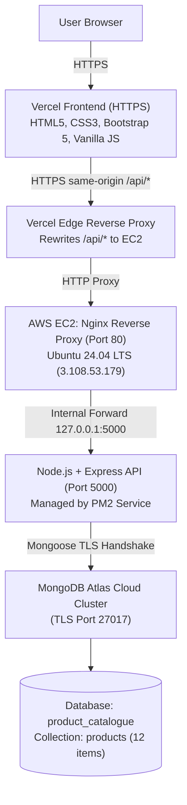

# ProductHub – System Architecture & Cloud Infrastructure

## 1. Production Architecture Overview

ProductHub is a cloud-native, full-stack product catalogue management system using a document-oriented MongoDB database. The production deployment implements a decoupled multi-tier cloud architecture spanning **Vercel** for static frontend delivery, an **AWS EC2 (Ubuntu Linux)** virtual machine for the application tier, and **MongoDB Atlas** for the managed database tier.

---

## 2. Deployment Components

### 2.1 Frontend Tier – Vercel
- **Repository:** `gaganv07/product-hub`
- **Root Directory:** `frontend`
- **Production URL:** [https://producthub-frontend-two.vercel.app](https://producthub-frontend-two.vercel.app)
- **Technology:** HTML5, CSS3, Bootstrap 5, Vanilla JavaScript.
- **API Resolution (`frontend/js/config.js`):**
  - **Local Development:** Targets `http://localhost:5000`.
  - **Production Deployment:** Configured with `PRODUCTION_API_BASE_URL = 'http://3.108.53.179:5000'`. When accessed over HTTPS on Vercel, requests automatically use same-origin relative `/api/...` routes via `vercel.json` edge rewrites, completely preventing browser Mixed Content blocking.
  - **Runtime Overrides:** Fully preserves `window.PRODUCTHUB_CONFIG.API_BASE_URL` and `localStorage.getItem('PRODUCTHUB_API_URL')`.

### 2.2 Backend Application Tier – AWS EC2 Virtual Machine
- **Cloud Provider:** Amazon Web Services (AWS)
- **Instance Operating System:** Ubuntu 24.04 LTS (x86_64)
- **Public IPv4 Address:** `3.108.53.179`
- **Node.js Runtime:** `v22.23.5` (npm `10.9.9`)
- **Process Manager:** PM2 (running as systemd service `pm2-ubuntu` with autorestart and memory limits)
- **Application Port:** `5000` (internal Express application)
- **Reverse Proxy:** Nginx 1.24 (listening on port 80, forwarding all `/api` requests to `127.0.0.1:5000`)
- **API Health Endpoint:** `http://3.108.53.179/api/health` and `http://3.108.53.179:5000/api/health`

### 2.3 Database Tier – MongoDB Atlas Cloud
- **Cluster Hostname:** `producthubcluster.khsf2oa.mongodb.net`
- **MongoDB Engine:** MongoDB 7.0 (Replica Set across AWS availability zones)
- **Database Name:** `product_catalogue`
- **Collection Name:** `products`
- **Connection Security:** TLS 1.3 encrypted connection string via Mongoose connection pooling; strict SCRAM-SHA-256 database authentication.
- **Documents:** 12 verified production product records with embedded `specifications` subdocuments.

---

## 3. End-to-End Request and Data Flow

1. **User Interaction:** The user accesses the application at `https://producthub-frontend-two.vercel.app`.
2. **Static Asset Delivery:** Vercel's global CDN delivers `index.html`, `style.css`, and `app.js` with zero server lag.
3. **API Request Routing:**
   - All REST requests from `app.js` call `getApiUrl(endpoint)`.
   - On Vercel (HTTPS), requests are sent to same-origin `/api/...`.
   - Vercel's edge rewrite engine (`vercel.json`) proxies `/api/:path*` to the EC2 backend at `http://3.108.53.179/api/:path*`.
4. **Nginx Reverse Proxy:** Nginx on the EC2 Ubuntu VM receives incoming port 80 traffic, handles request buffering, and proxies traffic to `http://127.0.0.1:5000`.
5. **Express Controller Execution:** Express.js parses JSON bodies, validates required fields and SKU formats, and executes Mongoose operations.
6. **MongoDB Atlas Query:** Mongoose queries the `product_catalogue.products` collection over TLS.
7. **JSON Response:** The JSON result travels back through Nginx and Vercel to the browser, updating UI tables and cards reactively.

---

## 4. Database Design Rationale

E-commerce catalogues handle diverse product categories (e.g. Laptops, Smartphones, Audio, Accessories, and Home Appliances). 
Relational databases require complex join tables or sparse null-filled tables. 
ProductHub uses MongoDB's flexible document model where each document encapsulates its own nested `specifications` subdocument (RAM, storage, processor, etc.) alongside standardized business attributes (`productId`, `name`, `brand`, `category`, `price`, `stock`).

---

## 5. Security & Operations Configuration

- **Credential Isolation:** The MongoDB Atlas connection string is kept exclusively in `.env` on the EC2 VM and excluded from Git via `.gitignore`.
- **CORS Protection:** Express CORS middleware uses a strict validation regex allowing only `http://localhost:3000`, the production Vercel domain, and valid preview subdomains (`^product-?hub(-[a-z0-9_-]+)*\.vercel\.app$`).
- **PM2 Resilience:** PM2 automatically restarts the backend on failure or VM reboot (`pm2 startup` + `pm2 save`).
