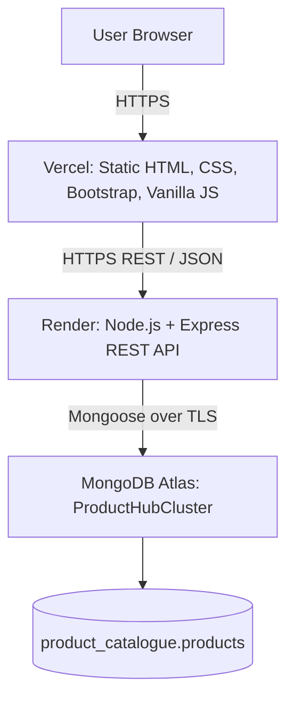

# ProductHub – System Architecture & Cloud Infrastructure

## 1. Current production architecture

ProductHub is a full-stack product catalogue application using a document-oriented MongoDB database. The currently deployed system is split across Vercel, Render, and MongoDB Atlas.

## 2. Deployment components

### 2.1 Frontend – Vercel
- Repository: `gaganv07/product-hub`
- Root directory: `frontend`
- Production URL: https://producthub-frontend-two.vercel.app
- Technology: HTML5, CSS3, Bootstrap 5, Vanilla JavaScript.
- Uses the configured production API origin in `frontend/js/config.js`.

### 2.2 Backend – Render
- Service: `producthub-api`
- Production URL: https://producthub-api-da3l.onrender.com
- Technology: Node.js, Express, Mongoose.
- Exposes product CRUD, search, dashboard statistics, and health endpoints.
- Uses Render-provided port configuration and environment variables.

### 2.3 Database – MongoDB Atlas
- Atlas project: `ProductHub-Production`
- Cluster: `ProductHubCluster`
- Database: `product_catalogue`
- Collection: `products`
- Documents use embedded `specifications` subdocuments to represent product-specific attributes.

## 3. Request and data flow

1. The user interacts with the frontend in a browser.
2. Vanilla JavaScript sends HTTPS requests to the Express API.
3. Express routes requests to controller logic and validates payloads.
4. Mongoose maps product data to MongoDB documents.
5. Atlas stores or returns the document.
6. The API responds with JSON and the frontend updates the catalogue or dashboard.

## 4. Database design rationale

The product catalogue contains heterogeneous categories such as laptops, smartphones, accessories, and home appliances. A document model allows each product to embed its own `specifications` object without requiring a large sparse relational table. The `productId` business key is unique; fields such as name, brand, category, price, image, stock, and timestamps support catalogue display and filtering.

## 5. Security and operations

- The MongoDB URI is stored as a Render environment secret, not in source control.
- Atlas Network Access restricts which sources can connect.
- The database user should be scoped to `readWrite` on `product_catalogue` only.
- Frontend-to-backend communication uses HTTPS.
- Production health checks use `/api/health`.

## 6. Infrastructure requirement status

AWS EC2 was not created because AWS account registration was not completed. Therefore, the current architecture does **not** include EC2, Ubuntu, Nginx, or PM2. If the assignment explicitly requires an IaaS VM, this remains a separate deployment task. Do not submit the previous EC2 architecture diagram as a representation of the running system.
