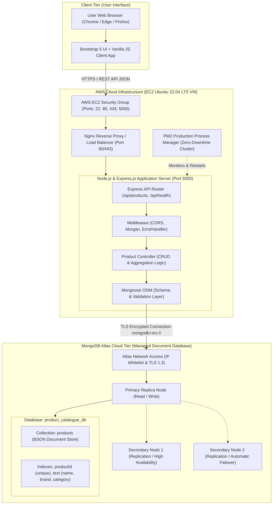
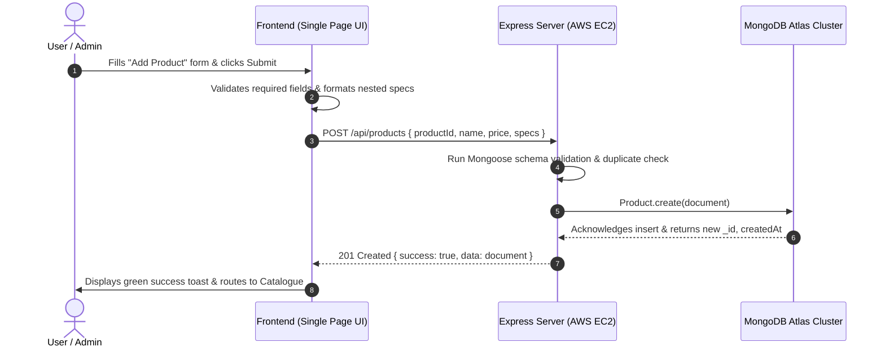

# ProductHub – System Architecture & Cloud Infrastructure

## 1. Executive Architecture Overview

**ProductHub** is a production-ready, cloud-native Product Catalogue Management System architected for enterprise retail and e-commerce use cases. It demonstrates the advantages of a **Document-Oriented Database (MongoDB Atlas)** over traditional relational databases for storing highly varied, nested, and extensible product specifications.

The application follows a decoupled multi-tier architectural pattern deployed on an **AWS EC2 Ubuntu Linux Virtual Machine** communicating securely with a distributed **MongoDB Atlas Cloud Cluster** over encrypted TLS/SSL connections.

---

## 2. System Architecture Diagram

---

## 3. Tier-by-Tier Architectural Breakdown

### 3.1. Client Presentation Tier
* **Technology:** HTML5, CSS3, Bootstrap 5.3, Bootstrap Icons, JavaScript (ES6+).
* **Role:**
  * Delivers a responsive admin dashboard and product catalogue.
  * Interacts with Express REST endpoints asynchronously via standard Web `fetch()` API.
  * Provides real-time client-side live document previewing and instant search filtering.
  * Manages UI notifications through non-intrusive Bootstrap toast messages and modal dialogues.

### 3.2. Web Server & Compute Tier (AWS EC2)
* **Compute Instance:** AWS EC2 `t2.micro` or `t3.small` running Ubuntu 22.04 LTS Linux.
* **Process Manager:** **PM2** ensures zero-downtime restarts, environment variable injection, log rotation, and auto-start on VM reboot.
* **Security Layer:** AWS Security Groups allow inbound traffic strictly on ports 22 (SSH admin access) and 80/443 (HTTP/HTTPS public access), with the Node.js application running safely on internal port 5000 behind reverse proxy.

### 3.3. Backend Application Tier (Node.js & Express.js)
* **Routing Layer:** RESTful endpoints for CRUD (`POST`, `GET`, `PUT`, `DELETE`).
* **Controller Layer:** Decoupled business logic handling pagination, multi-attribute regex search, aggregation pipeline calculations, and data sanitization.
* **Data Modeling & Validation Layer:** **Mongoose 8.x** enforces document schemas, regex validation for product identifiers, non-negative price constraints, and custom pre-save checks before persisting to disk.

### 3.4. Data Storage Tier (MongoDB Atlas)
* **Cluster Type:** Managed MongoDB Atlas Multi-AZ replica set ensuring 99.99% service uptime.
* **Document Engine:** WiredTiger storage engine with snappy document compression.
* **Data Format:** Binary JSON (BSON), enabling native nesting of technical specifications without foreign keys or expensive SQL table joins.

---

## 4. End-to-End Request & Data Flow

---

## 5. High Availability & Disaster Recovery Strategy
1. **Automated Failover:** MongoDB Atlas replica sets elect a new primary node in under 3 seconds in the event of hardware degradation.
2. **Crash Resilience:** PM2 on the EC2 VM automatically restarts any crashed Node.js worker instance within milliseconds.
3. **Connection Pooling:** Mongoose maintains an active pool of database socket connections, recycling connections rather than incurring the overhead of frequent handshakes.

